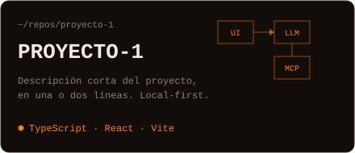
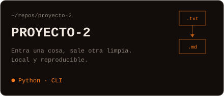
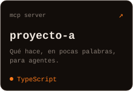
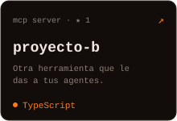
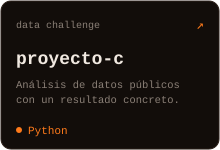
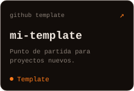

<!--
  Perfil estilo terminal de Ariel Michelli.
  Pendiente: reemplazar TU-USUARIO por tu usuario de GitHub y los textos de ejemplo
  de las tarjetas (card-*.svg) por tus proyectos reales.
-->

  

<!--
  Cuando tengas sitio web o LinkedIn, descomentá esta línea y poné tus links:

  <a href="https://tu-sitio.com">tu-sitio.com</a> · <a href="https://www.linkedin.com/in/tu-usuario">LinkedIn</a>

-->

  
  

  
  
  
  

